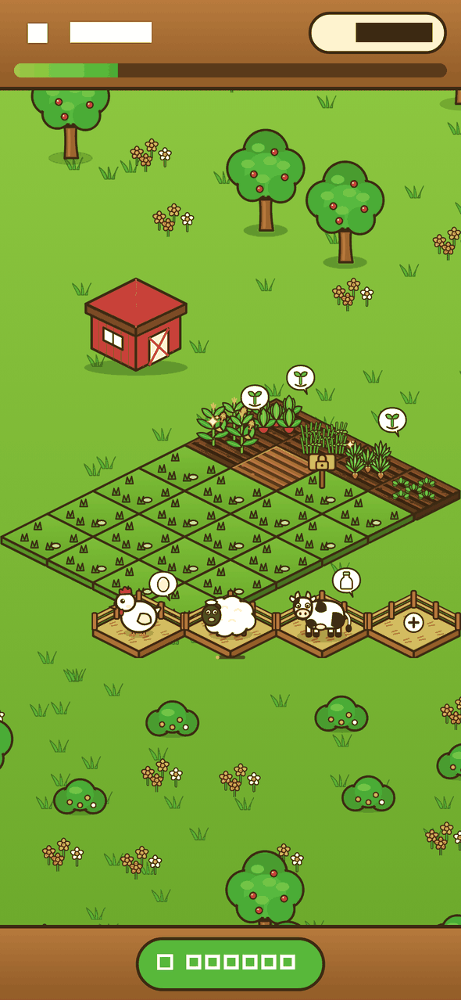

# Ферма 2007

«Ферма 2007» — ферма для iPhone в духе браузерных ферм из соцсетей конца 2000-х.

- `server/` — сервер (Node 22, без зависимостей, SQLite). Запуск: `cd server && npm start`, тесты: `npm test`.
- `app/` — клиент на Flutter + Flame (iOS): вход, ферма, посадка, сбор, покупка грядок. Запуск на симуляторе: `cd app && flutter run --dart-define=API_URL=http://localhost:3000` (сервер должен быть запущен). Есть соседи, воровство урожая и животные (курица, овца, корова).



*Скриншот собран тестом `app/test/scene_test.dart` (шрифт в тестах заменён квадратами, на устройстве текст обычный). Вся графика оригинальная и генерируется кодом, см. `tools/sprites/README.md`.*

Графика сейчас MVP. Подробное ТЗ с промтами для новой, более «пышной» графики: [docs/ART_BRIEF.md](docs/ART_BRIEF.md).

## E2E-тесты

Сквозные тесты приложения на симуляторе iPhone — на [e2e](https://github.com/e2e-inc/e2e) (движок `@e2e-dev/mobile`). Проект тестов — папка `e2e/`, конфиг `e2e/e2e.config.ts`, тесты `e2e/tests/`. Сервер тесты запускают сами (`server/`, порт 3000, база в памяти — каждый прогон с чистого листа).

Нужен Mac с Xcode, Flutter и Node 22.22.3+:

```bash
open -a Simulator                                   # или xcrun simctl boot "iPhone 17 Pro"
cd app && flutter build ios --simulator && xcrun simctl install booted build/ios/iphonesimulator/Runner.app
cd ../e2e && npm ci
npx e2e list                                        # конфиг загружается, тесты видны
npx e2e run                                         # все тесты; один файл: npx e2e run tests/login.e2e.ts
```

После изменений в клиенте приложение нужно пересобрать и переустановить: тесты открывают то, что установлено.

- `smoke`, `login`, `friends` — точные проверки (вход, новая ферма с 200 монетами, добавление соседа), без ИИ.
- `farm.agent.e2e.ts` — шаги `agent.act` / `agent.assert` (посадить редис на нарисованном поле). Их выполняет Claude Code по подписке: локально нужен вошедший `claude`, в CI — секрет репозитория `CLAUDE_CODE_OAUTH_TOKEN` (получить командой `claude setup-token`). Без секрета в CI эти тесты пропускаются; локально пропустить: `E2E_SKIP_AGENT=1`.

Результаты: `e2e/.e2e/report.json`, у упавшего теста — `e2e/.e2e/results/<тест>/trace.md`. В CI тесты гоняет workflow `.github/workflows/e2e.yml` (macOS, симулятор iOS) на PR с изменениями в `app/`, `server/`, `e2e/`; отчёт — артефакт `e2e-ios`.

Навык проверки для агентов: `.agents/skills/verify-ferma2007/` (он же `.claude/skills/verify-ferma2007`) — как запустить приложение, проверить, что оно живо, провести фичу и доказать изменение; карта фич с тестами и чартерами для баг-баша — в `features/`.

## Команда ИИ-агентов

Проект ведёт «студия» ИИ-агентов по модели [paperclip](https://github.com/paperclipai/paperclip): у агентов есть роли и подчинённость, задачи живут на доске Trello (Backlog → Todo → In Progress → In Review → Done), у каждой задачи два этапа контроля (ревью и одобрение), а решения о деньгах, названии, релизах и юристах принимает владелец. Подробно: [company/COMPANY.md](company/COMPANY.md), правила: [company/GOVERNANCE.md](company/GOVERNANCE.md).

## API

`POST /register {name}` → `{token, farm}`; дальше заголовок `Authorization: Bearer <token>`.

| Метод | Путь | Описание |
|---|---|---|
| GET | `/catalog` | Список культур |
| GET | `/farm` | Моя ферма |
| POST | `/plant {plot, cropId}` | Посадить |
| POST | `/harvest {plot}` | Собрать урожай |
| POST | `/unlock-plot` | Купить новую грядку |
| GET | `/animal-catalog` | Список животных |
| POST | `/animals/buy {slot, kind}` | Купить животное в загон |
| POST | `/animals/collect {slot}` | Собрать продукт |
| GET/POST | `/friends` | Друзья / добавить `{name}` (дружба взаимная) |
| GET | `/friends/:id/farm` | Ферма друга |
| POST | `/friends/:id/steal {plot}` | Украсть у друга (по 10%, максимум 50% с грядки, один раз на вора) |

Время роста считается на сервере, клиенту доверять нельзя.
